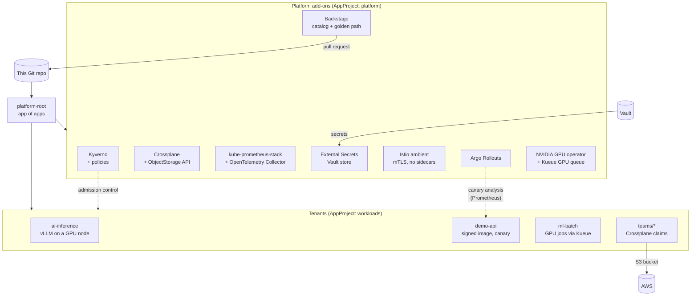

# platform-gitops

[](https://github.com/Engdarwish2019/platform-gitops/actions/workflows/ci.yml)


An internal developer platform on Kubernetes, managed entirely through Git. One script installs
Argo CD; Argo CD then installs everything else from this repository: policy, self-service
infrastructure, observability, secrets from Vault, a zero-trust service mesh, canary releases with
automatic rollback, GPU support with batch queueing, a developer portal and team workloads,
including an LLM served with vLLM on GPU nodes.

It runs on the clusters from [multicloud-k8s-terraform](https://github.com/Engdarwish2019/multicloud-k8s-terraform)
(EKS, AKS or GKE) and deploys the signed image from [devsecops-pipeline](https://github.com/Engdarwish2019/devsecops-pipeline).

## Architecture



Sync waves order the rollout: projects (-10), Istio CRDs (-7), the mesh and External Secrets
(-6), Kyverno, Crossplane and the Vault secret store (-5), policies and monitoring (-4), Argo
Rollouts, Kueue, the collector and the GPU operator (-3), queues and Crossplane APIs (-2),
Backstage (0), then tenants (5). A health check for child Applications
(`bootstrap/argocd-values.yaml`) makes each wave wait until the previous one is **Healthy**, so a
CRD always exists before anything that uses it, and every app retries a failed sync with backoff.

## Platform pieces

| Area | What is here |
|---|---|
| **GitOps** | Argo CD app of apps, two AppProjects (`platform` for add-ons, `workloads` for teams, namespaced resources only), ApplicationSets that create one app per folder in `workloads/` and `teams/` |
| **Policy as code** | Kyverno policies for tenant namespaces: Pod Security `restricted`, required labels, CPU/memory requests and memory limit, no `latest` tag, approved registries only, **Cosign keyless signature verification** for images from the devsecops pipeline |
| **Self-service infrastructure** | Crossplane XRD + Composition: a team commits a 6-line `ObjectStorage` claim and gets an S3 bucket that is always private, KMS encrypted and versioned. The provider authenticates with IRSA, no keys in the cluster |
| **Observability** | kube-prometheus-stack (Prometheus, Alertmanager, Grafana) and an OpenTelemetry Collector that receives OTLP and remote-writes metrics to Prometheus. Grafana's admin secret is created outside Git |
| **GPU / AI** | NVIDIA GPU operator (device plugin, toolkit, DCGM exporter with ServiceMonitor), vLLM serving `Qwen2.5-0.5B-Instruct` with an OpenAI-compatible API, scheduled on tainted GPU nodes, running as non-root with a read-only root filesystem |
| **Progressive delivery** | Argo Rollouts canary for `demo-api`: 25% of pods, then an `AnalysisTemplate` reads the canary's own 5xx ratio from Prometheus (the pods' template hash is kept as a metric label) and aborts above 5%; then 50%, checked again, then promoted. HPA (4-10 replicas) and a PodDisruptionBudget |
| **Secrets** | External Secrets Operator with a `ClusterSecretStore` on Vault (Kubernetes auth, read-only policy on `secret/platform/*`). Grafana's admin login comes from Vault, never from Git. The app itself uses the other Vault pattern, the Agent injector, in [devsecops-pipeline](https://github.com/Engdarwish2019/devsecops-pipeline) |
| **Zero-trust networking** | Istio **ambient** mode (ztunnel, no sidecars, so Pod Security `restricted` still holds): STRICT mutual TLS in `demo-api` and an `AuthorizationPolicy` that only lets Prometheus in, on top of default-deny NetworkPolicies |
| **GPU batch scheduling** | Kueue `ClusterQueue` with a GPU quota (the Kubernetes counterpart of a Slurm partition with a GPU limit) on the same GPU node flavor vLLM uses; tenants submit to a `LocalQueue`, as the `ml-batch` CUDA smoke-test Job does |
| **Developer portal** | Backstage with a catalog of the platform and a **golden-path template** that opens a pull request adding a namespace and a Deployment that already passes every policy |

## Getting started

```bash
# A cluster from multicloud-k8s-terraform, kubeconfig pointing at it
./bootstrap/install.sh

kubectl -n argocd port-forward svc/argocd-server 8080:443
# https://localhost:8080 shows every app syncing in wave order
```

Then try the platform as a tenant:

```bash
# Policies at work: this pod is rejected (latest tag, no resources, untrusted registry)
kubectl -n demo-api run test --image=nginx:latest

# Canary release: change the image tag in workloads/demo-api/rollout.yaml, push, then watch
# the steps and the Prometheus analysis (kubectl plugin: kubectl-argo-rollouts)
kubectl argo rollouts get rollout demo-api -n demo-api --watch

# GPU batch: Kueue admits the CUDA smoke test once the gpu queue has quota
kubectl -n ml-batch get workloads,jobs
kubectl -n ml-batch logs job/cuda-vectoradd

# Ask the LLM (once a GPU node is up)
kubectl -n ai-inference port-forward svc/vllm 8000:8000
curl -s localhost:8000/v1/chat/completions -H 'Content-Type: application/json' \
  -d '{"model":"Qwen/Qwen2.5-0.5B-Instruct","messages":[{"role":"user","content":"What is Slurm?"}]}'
```

Before the first sync, replace the placeholders: the IAM role ARN in
`platform/crossplane/providers.yaml` and the Argo CD domain in `bootstrap/argocd-values.yaml`.
Vault comes from [devsecops-pipeline](https://github.com/Engdarwish2019/devsecops-pipeline)
(`vault/setup.sh`); put its CA in the `vault-ca` ConfigMap in `external-secrets` and store the
Grafana login with `vault kv put secret/platform/grafana admin-user=admin admin-password=...`.
Istio ambient is set up for EKS; on GKE add `global.platform: gke` to `platform/istio/values.yaml`,
and check Istio's [platform prerequisites](https://istio.io/latest/docs/ambient/install/platform-prerequisites/)
for AKS before enabling it there.

## CI

| Job | What it checks |
|---|---|
| yamllint / shellcheck | Style of all YAML and the bootstrap script |
| kubeconform | Every manifest against Kubernetes schemas and the CRD schemas of Argo CD, Argo Rollouts, Kyverno, Crossplane, Prometheus Operator, External Secrets, Istio and Kueue |
| kyverno test | Runs the policies against test pods: two compliant pods (the app and an NVIDIA NGC GPU job) pass, five others each break one rule and must be rejected |
| checkov / gitleaks | Kubernetes misconfiguration scan of the workloads, secrets scan of the history |

Chart and image versions are kept current by Renovate (`renovate.json`).

## Layout

```text
bootstrap/           Argo CD install script, values and root app
apps/                Argo CD Applications, ApplicationSets and AppProjects
policies/kyverno/    ClusterPolicies + kyverno CLI tests
platform/            Helm values, Crossplane XRD and Composition, Vault secret store, Kueue queues
backstage/           Catalog and the new-service golden-path template
workloads/           One folder per tenant namespace (vLLM, canary demo API, GPU batch jobs)
teams/               Crossplane claims committed by teams
```

## License

MIT
